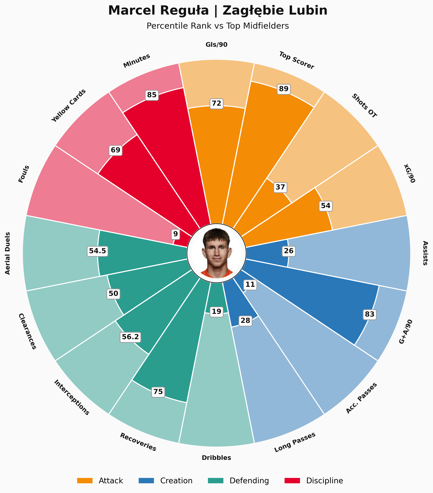

# Marcel Reguła

## Profil z wykresu pizza

### Analiza
Marcel Reguła prezentuje profil skrzydłowego o wyraźnym wkładzie ofensywnym. Wykres wskazuje na aktywność w strefach prowadzenia i kończenia akcji oraz gotowość do podejmowania ruchów poza linię obrony rywala. Jego pozycjonowanie i udział w ostatniej tercji sprawiają, że może rozszerzać atak i jednocześnie dołączać do sytuacji podbramkowych.

### Mocne strony
- Aktywne dochodzenie do pola karnego i udział w kończeniu akcji.
- Możliwość gry szeroko oraz prowadzenia ataku po prawej stronie.
- Ruch bez piłki i wejścia na drugą linię, które tworzą przewagi pozycyjne.
- Potencjał do współpracy z partnerami przy przenoszeniu akcji.

### Obszary do poprawy
- Większa konsekwencja w pracy defensywnej po utracie piłki.
- Precyzyjniejsze decyzje przy ostatnim podaniu i dośrodkowaniu.
- Lepsze ustawienie przy szybkim przejściu rywala z obrony do ataku.

### Najlepsza role
Marcel Reguła najlepiej funkcjonuje jako prawy skrzydłowy lub zawodnik ofensywnego skrzydła wykorzystujący szerokość boiska i możliwość wejścia do pola karnego.

### Wniosek
Profil Marcela Reguły ma wyraźną orientację ofensywną i wykorzystuje ruch oraz aktywność na prawym skrzydle. Rozwój powinien koncentrować się na regularności finalizacji i jakości decyzji w ostatniej fazie akcji.

### Źródło
Analiza opracowana na podstawie wykresu `Marcel_Regula_Pizza.png`.
