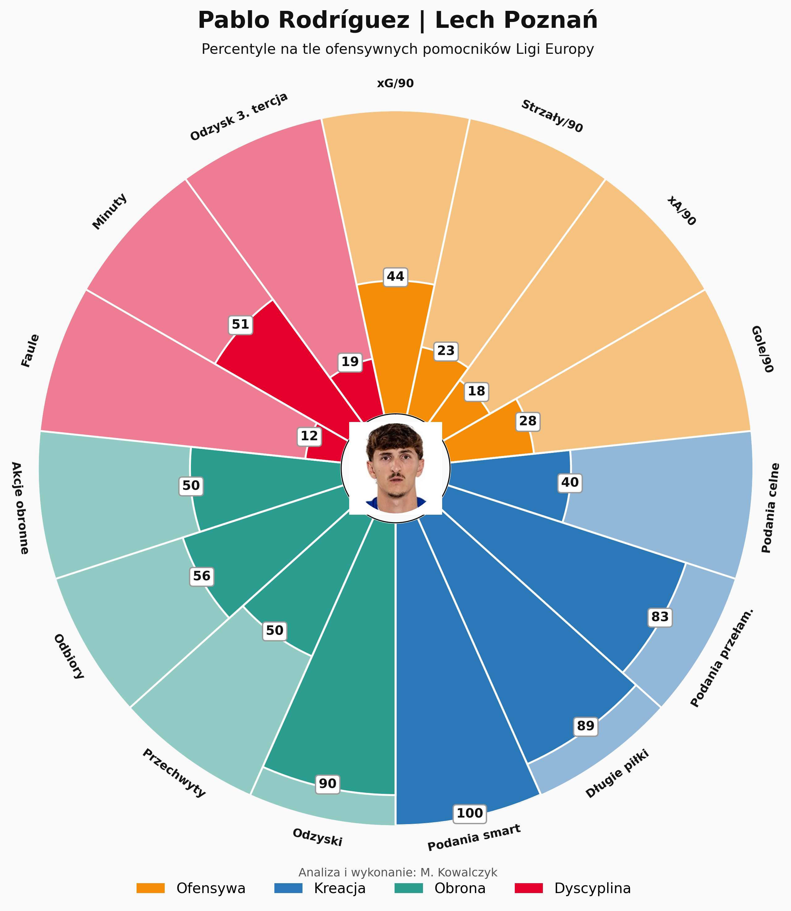

# Pablo Rodriguez

## Profil z wykresu pizza

### Analiza
Pablo Rodriguez prezentuje ofensywno-kreatywny profil zawodnika z możliwością wpływania na gry zespołu z różnych stref ostatniej tercji. Wykres wskazuje na udział w budowaniu sytuacji oraz gotowość do ruchu w stronę pola karnego. Jego elastyczność pozwala mu działać pomiędzy skrzydłem a linią pomocy, tworząc partnerom przestrzeń i warianty podania.

### Mocne strony
- Aktywność w strefach ofensywnych i częste dochodzenie do sytuacji bramkowych.
- Potencjał kreacyjny oraz udział w prowadzeniu akcji.
- Możliwość pracy na skrzydle i jako zawodnik drugiej linii.
- Ruchy bez piłki oraz zdolność do zmiany kierunku ataku.

### Obszary do poprawy
- Zwiększenie skuteczności i regularności finalizacji.
- Precyzyjniejsze wybory w presji w ostatniej tercji.
- Większa konsekwencja w ustawieniu i pracy defensywnej po utracie piłki.

### Najlepsza role
Pablo Rodriguez najlepiej pasuje do pozycji ofensywnego pomocnika, wewnętrznego skrzydłowego lub zawodnika poruszającego się między liniami. W takim wykorzystaniu może jednocześnie wspierać napastnika i uczestniczyć w budowie akcji.

### Wniosek
Profil Pabla Rodrigueza wskazuje na zawodnika o wysokim potencjale ofensywnym i mobilności. Największy wzrost można uzyskać dzięki poprawie skuteczności kończenia akcji oraz większej konsekwencji w decyzjach defensywnych i bez piłki.

### Źródło
Analiza opracowana na podstawie wykresu `Pablo_Rodriguez_pizza.png`.
