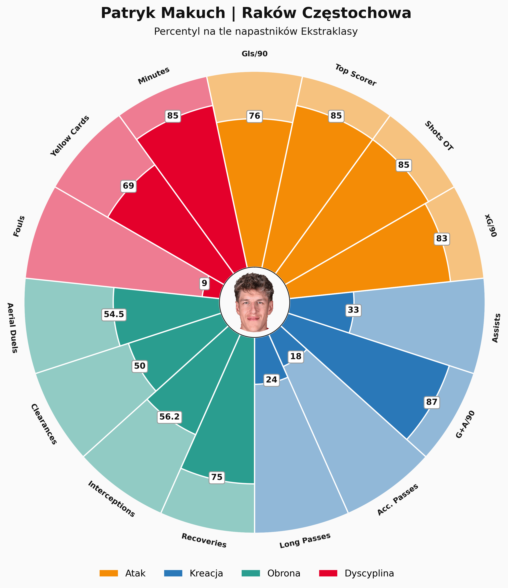

# Patryk Makuch

## Profil z wykresu pizza

### Analiza
Patryk Makuch to napastnik o profilu finalizującym, którego głównym atutem jest regularne dochodzenie do sytuacji strzeleckich i skuteczność pod bramką przeciwnika. Osiąga wysokie wartości w zakresie goli, strzałów celnych oraz xG. W mniejszym stopniu uczestniczy w kreowaniu gry i rozegraniu zespołu. Najlepiej funkcjonuje jako zawodnik odpowiedzialny za wykańczanie akcji w polu karnym.
