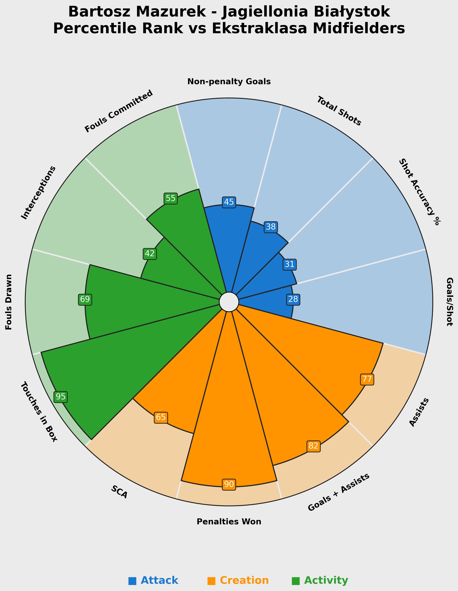
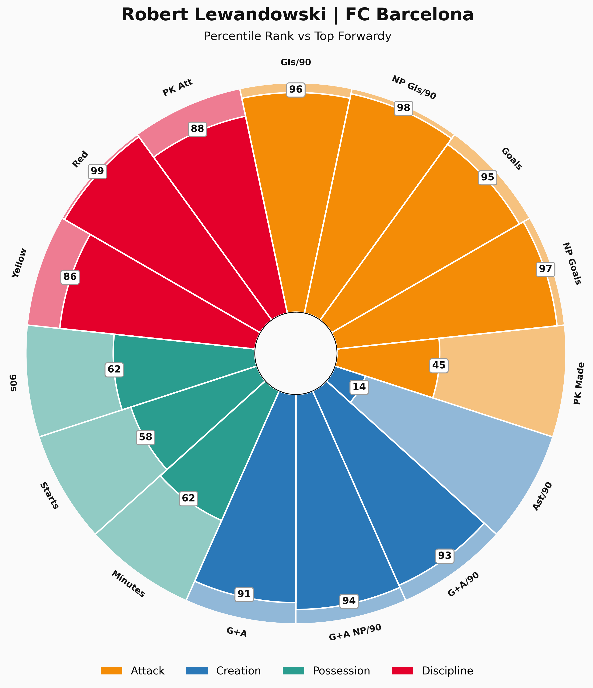
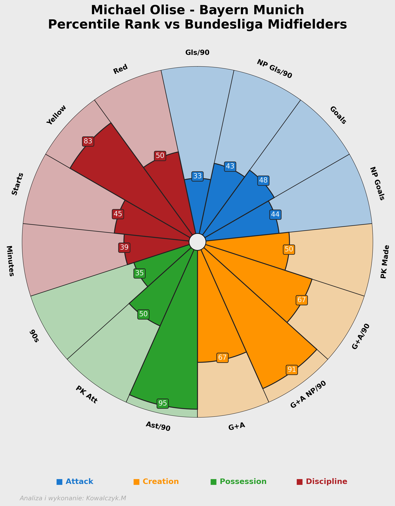
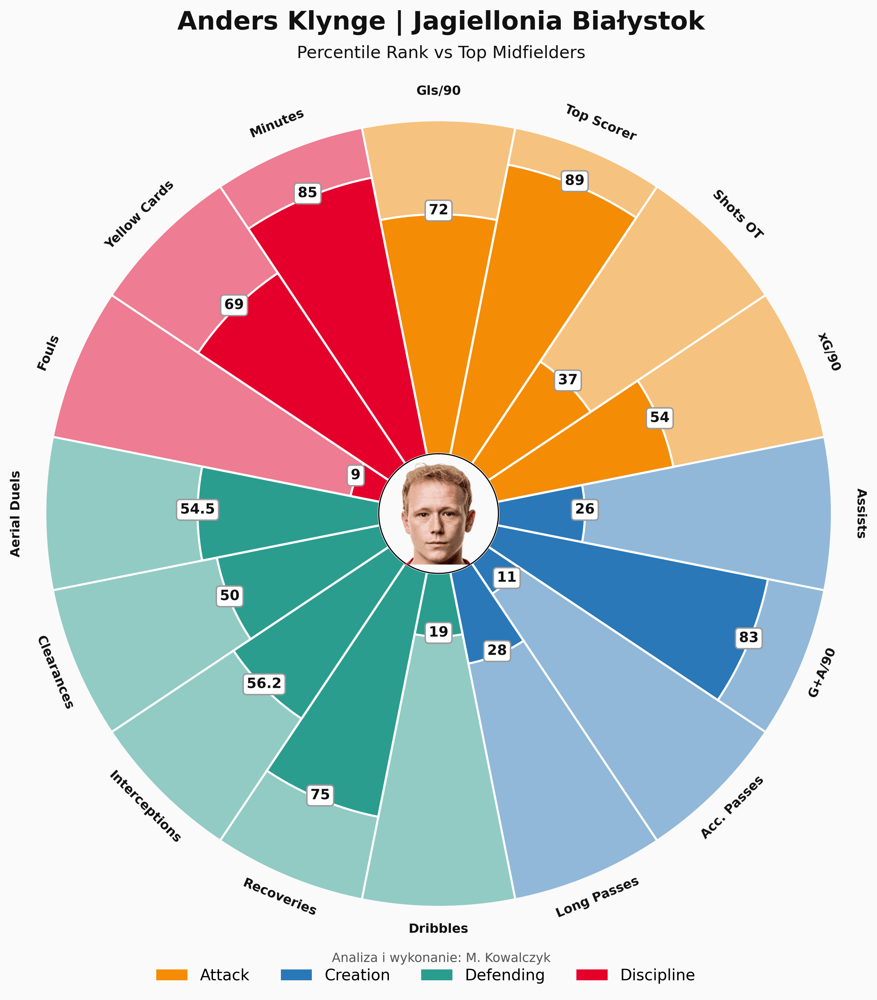
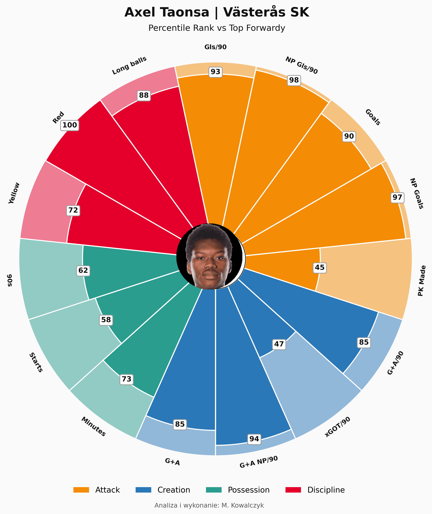

# Football Players Pizza Chart Analysis

## Mazurek

Mazurek is known for his excellent dribbling skills and agility on the field. The pizza chart shows his performance metrics, emphasizing his strengths in key areas.

## Lewandowski

Robert Lewandowski is one of the most prolific finishers in football history. His pizza chart indicates outstanding performance in goal-scoring and positioning.

## Olise

Michael Olise, a rising star, showcases his creativity and playmaking abilities in his pizza chart. The analysis reflects his contributions to the team's offensive strategies.

## Anders Klynge

Anders Klynge is a technically capable and versatile central midfielder whose profile combines attacking contribution, passing range and defensive activity. His statistical profile is especially strong in goal involvement and non-penalty scoring.

### 🟢 Anders Klynge (Jagiellonia Białystok)
- [Wykres-pizza](Anders_Klynge_pizza.png)
- [Pełna analiza profilu](Andera%20Klynge.md)

## Axel Taonsa

Axel Taonsa presents a strong attacking profile with particularly high percentile rankings in non-penalty goals, non-penalty G+A/90, goals and goals/90. A high-level forward profile with strong scoring output and attacking impact.

## Marcel Reguła

Marcel Reguła działał głównie jako wysoki prawy skrzydłowy, koncentrując aktywność w prawym sektorze i w okolicach pola karnego. Heatmapa pokazuje duże zaangażowanie ofensywne, ruch bez piłki, wejścia w przestrzeń za linią obrony oraz aktywność w strefie końcowej.

## Wojciech Urbański

Wojciech Urbański był zaangażowany głównie w strefy centralne oraz między polem środkowym a polem karnym rywala. Heatmapa pokazuje dużą aktywność w budowaniu akcji i przekazywaniu piłki w fazie organizacji, z naciskiem na pracę w środkowej części boiska.

### 🟢 Axel Taonsa (Västerås SK)
- [Wykres-pizza](Axel_Taonsa_pizza.png)
- [Pełna analiza profilu](Axel_Taonsa.md)

### 🟢 Marcel Reguła
- [Heatmapa](Marcel_Regula_heatmap.svg)
- [Pełna analiza profilu](Marcel_Regula.md)

### 🟢 Wojciech Urbański
- [Heatmapa](Wojciech_Urbanski_heatmap.svg)
- [Pełna analiza profilu](Wojciech_Urbanski.md)

### 🟢 Mazurek (Jagiellonia Białystok)
- [Wykres-pizza](mazurek_pizza.png)
- [Pełna analiza profilu](ANALIZA_MAZUREK.md)
