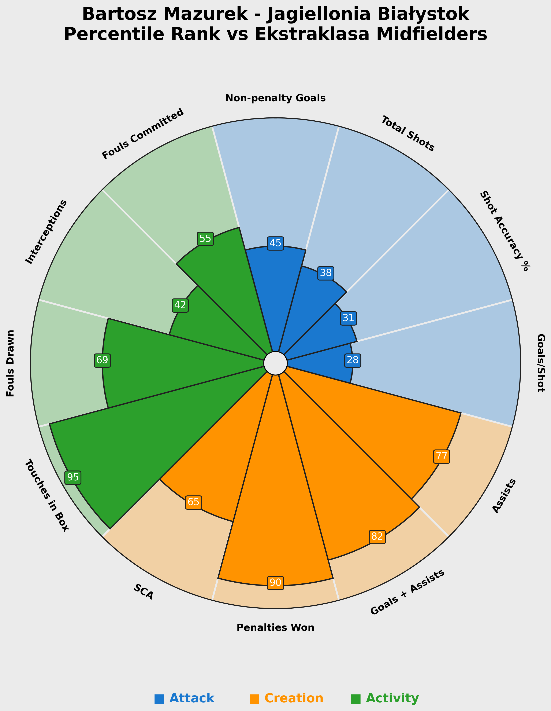
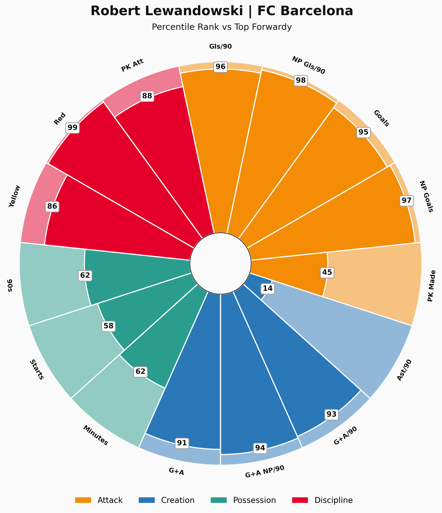
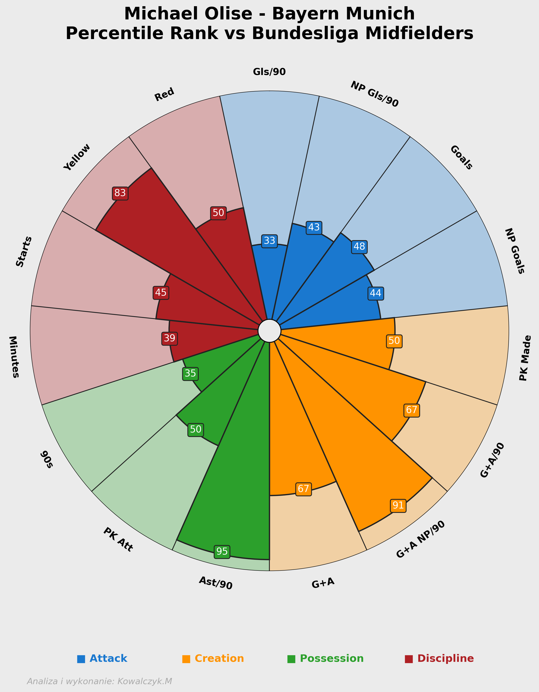
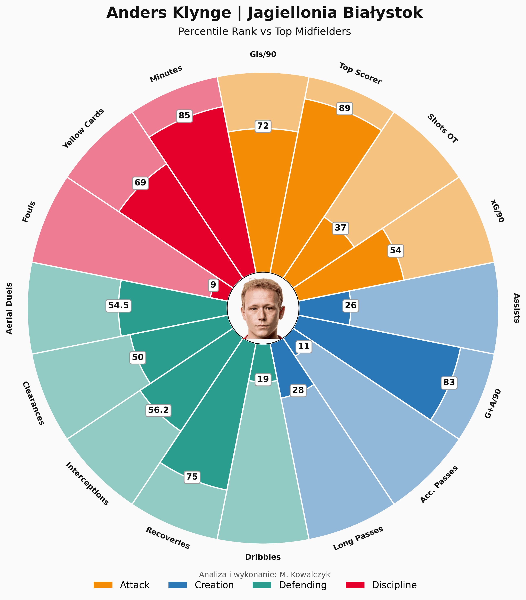
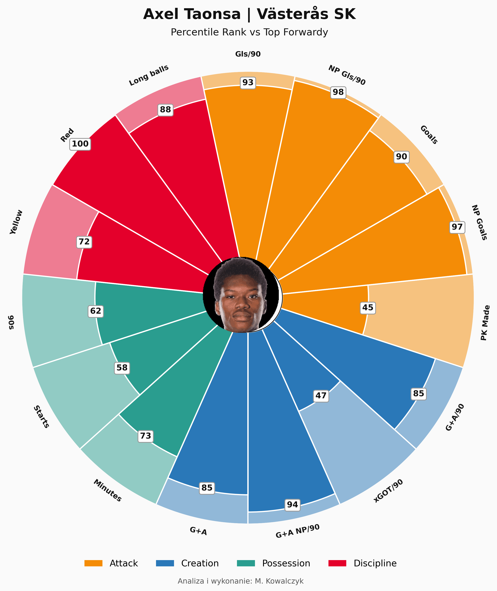
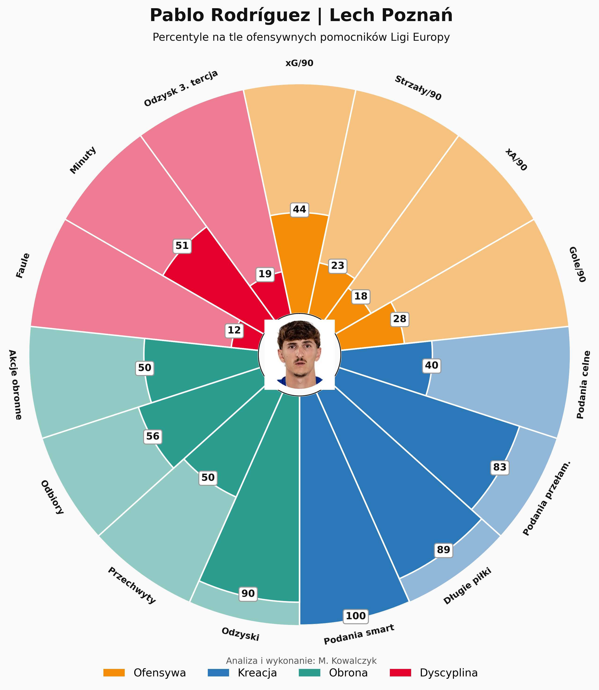
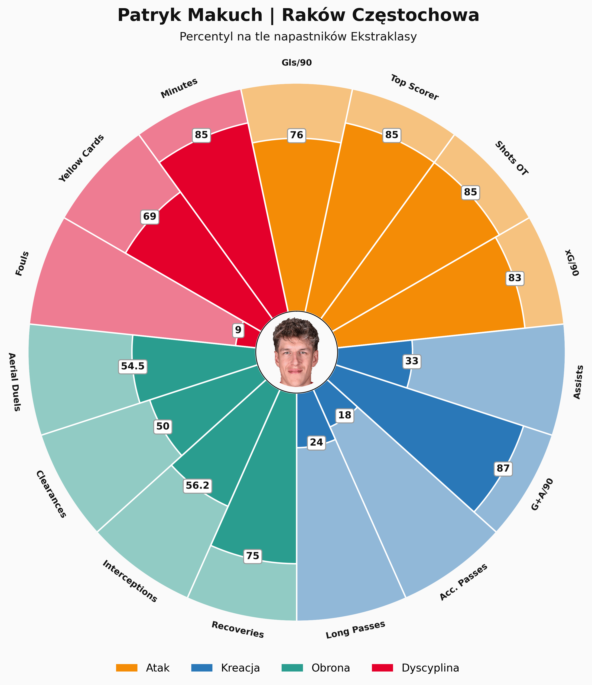
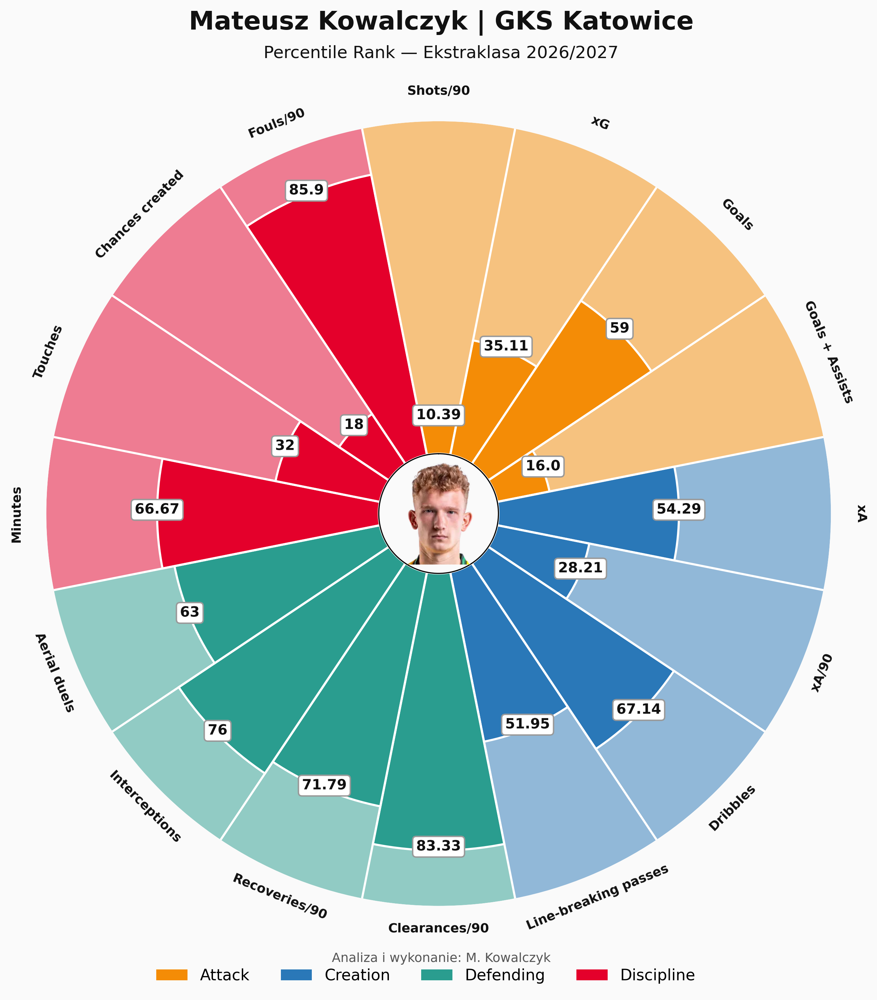

# Football Players Pizza Chart Analysis

## Mazurek

Mazurek is known for his excellent dribbling skills and agility on the field. The pizza chart shows his performance metrics, emphasizing his strengths in key areas.

- [Wykres-pizza](mazurek_pizza.png)
- [Pełna analiza profilu](ANALIZA_MAZUREK.md)

## Lewandowski

Robert Lewandowski is one of the most prolific finishers in football history. His pizza chart indicates outstanding performance in goal-scoring and positioning.

## Olise

Michael Olise, a rising star, showcases his creativity and playmaking abilities in his pizza chart. The analysis reflects his contributions to the team's offensive strategies.

## Anders Klynge

Anders Klynge is a technically capable and versatile central midfielder whose profile combines attacking contribution, passing range and defensive activity.

- [Wykres-pizza](Anders_Klynge_pizza.png)
- [Pełna analiza profilu](Andera%20Klynge.md)

## Axel Taonsa

Axel Taonsa presents a strong attacking profile with particularly high percentile rankings in non-penalty goals, non-penalty G+A/90, goals and goals/90.

- [Wykres-pizza](Axel_Taonsa_pizza.png)

## Marcel Reguła

Marcel Reguła prezentuje profil skrzydłowego o wyraźnym wkładzie ofensywnym. Wykres wskazuje na aktywność w strefach prowadzenia i kończenia akcji oraz gotowość do podejmowania ruchów do pola karnego.

- [Wykres-pizza](Marcel_Regula_Pizza.png)
- [Pełna analiza profilu](Marcel_Regula.md)
- [Heatmapa](Marcel_Regula_heatmap.svg)

## Pablo Rodriguez

Pablo Rodriguez prezentuje ofensywno-kreatywny profil zawodnika z możliwością wpływania na gry zespołu z różnych stref ostatniej tercji.

- [Wykres-pizza](Pablo_Rodriguez_pizza.png)
- [Pełna analiza profilu](Pablo_Rodriguez.md)

## Patryk Makuch

Patryk Makuch to napastnik o profilu finalizującym, którego głównym atutem jest regularne dochodzenie do sytuacji strzeleckich i skuteczność pod bramką przeciwnika.

- [Wykres-pizza](Patryk_Makuch_Pizza.png)
- [Pełna analiza profilu](Patryk_Makuch.md)

## Mateusz Kowalczyk

Mateusz Kowalczyk to zawodnik o wyraźnym profilu ofensywno-kreatywnym, z udziałem w tworzeniu akcji i aktywnością w strefie końcowej.

- [Wykres-pizza](Mateusz_Kowalczyk_pizza.png)
- [Pełna analiza profilu](Mateusz_Kowalczyk.md)

## Wojciech Urbański

Wojciech Urbański był zaangażowany głównie w strefy centralne oraz między polem środkowym a polem karnym rywala.

- [Heatmapa](Wojciech_Urbanski_heatmap.svg)
- [Pełna analiza profilu](Wojciech_Urbanski.md)
